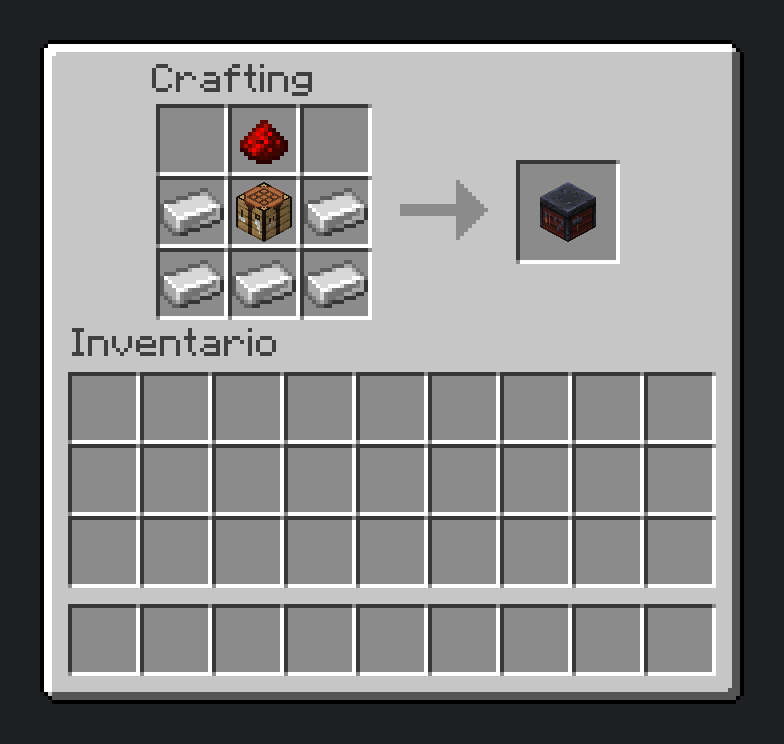
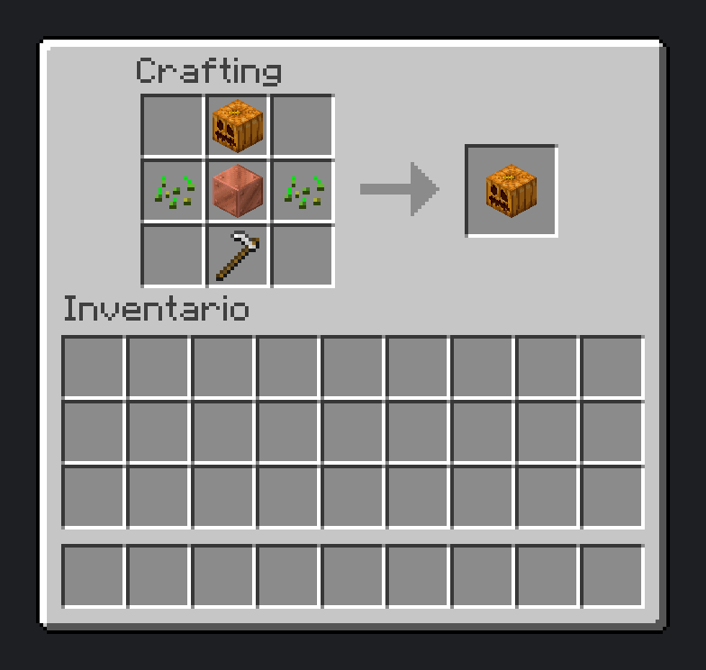
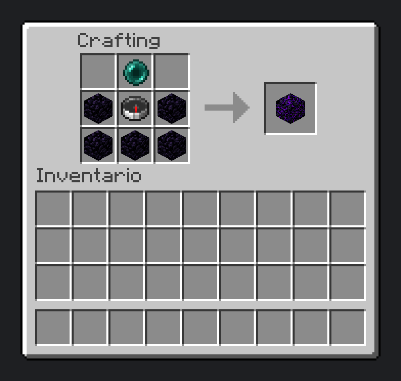
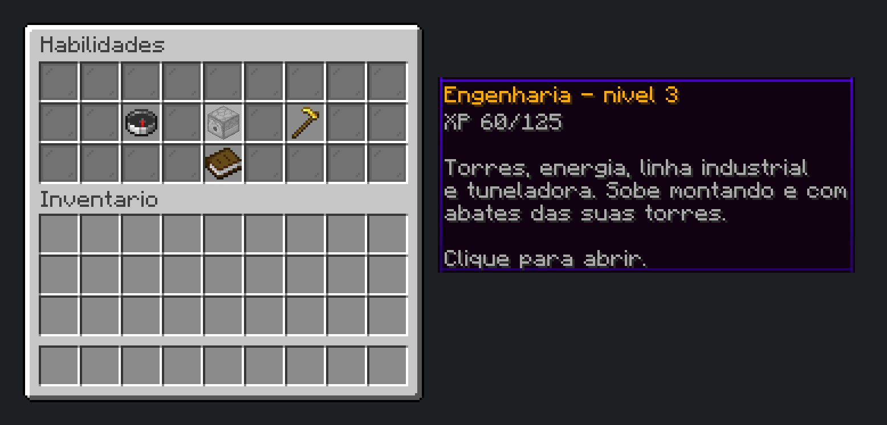
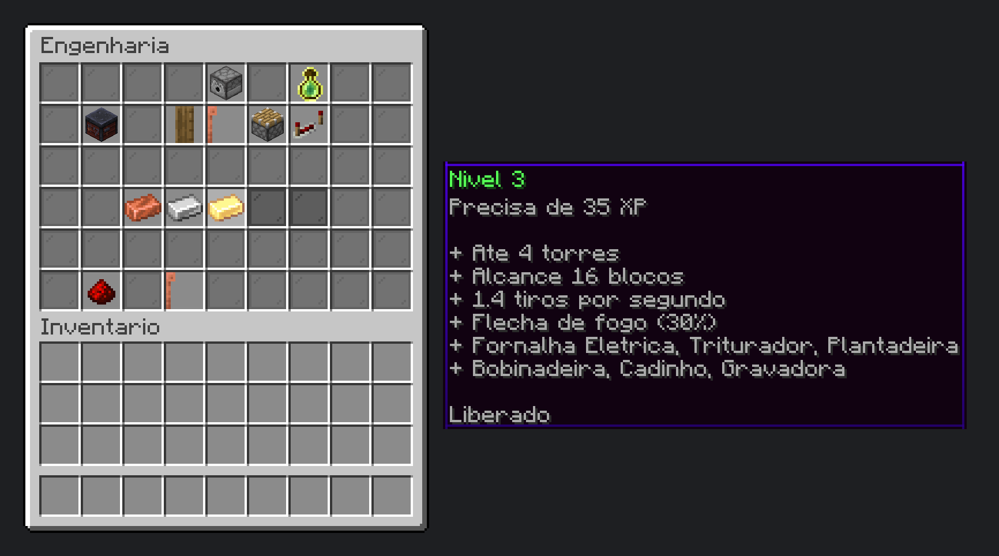
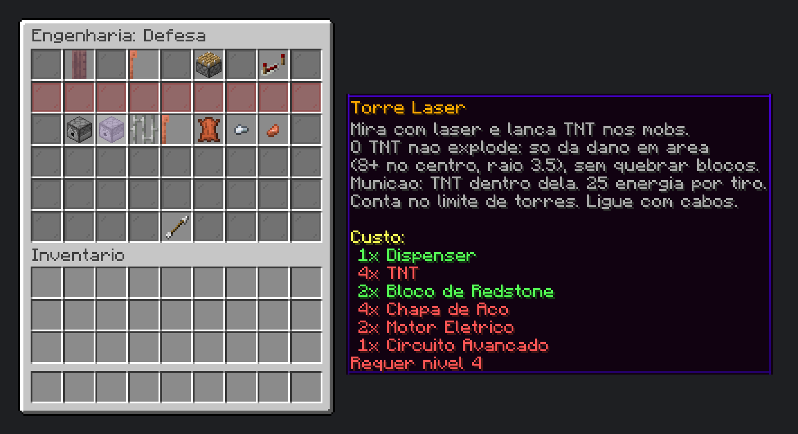

# Classforge

**English** | [Portugues (pt-BR)](README.pt-BR.md)

    

> **Beta.** Classforge is in active development: expect changes and rough edges. It is fully open source (MIT) and community ideas are welcome. Suggest features or report bugs in the [issues](https://github.com/matheus-fsc/classforge/issues/new/choose).


A Paper plugin for **level-based skills** with no fixed classes. Every player levels Engineering, Exploration and Farming, and each level unlocks new content: defense turrets, power and machines, companions and teleporting, automatic planters and rare enchanted books. Everything is configurable (worlds, modules, balance and recipes).

In-game text is currently in Brazilian Portuguese (pt-BR). An English translation of the messages is planned.

Works on its own on any Paper server. With [HardcoreRoulette](https://github.com/matheus-fsc/hardcore-roulette) it gains special features: see [HardcoreRoulette integration](#hardcoreroulette-integration).

## Features

- **Engineering**: defense turrets (Sentry and Laser), power generation, cables and poles, machines, an industrial production chain and a Tunnel Borer.
- **Exploration**: a companion pet, the Pearl Anchor teleport, XP bonuses and Ancient Books found in structure chests.
- **Farming**: the Copper Planter (a golem that sows seeds from a chest) and extra harvest.
- Custom menus with the 3x3 recipe of every item, floating status labels and power particles.

## Installation

1. A **Paper 26.3** server running **Java 25**.
2. Drop `Classforge.jar` into `plugins/` and restart.
3. Optional: [HardcoreRoulette](https://github.com/matheus-fsc/hardcore-roulette) for the special features.

Upgrading from the old version (HardcoreRouletteClasses): just swap the jar. On first start Classforge copies the data from `plugins/HardcoreRouletteClasses/`, and the items, machines and books already in your worlds keep working.

## HardcoreRoulette integration

HardcoreRoulette is a group hardcore plugin where every life is a brand new world. With it installed, Classforge adds:

- **Life per world**: levels are tied to the run's world and go back to level 1 when the life ends (`progress.reset-on-new-world: true`, `worlds.mode: prefix`, `worlds.prefix: "hc_"`).
- **Party XP sharing**: part of the skill XP goes to your party members, using HardcoreRoulette's range and ratio (`progress.party-share`).
- **Ancient Books in runs**: book loot only appears in run worlds.

Without HardcoreRoulette these features are off and everything else works the same. The link uses HardcoreRoulette's official API as an optional dependency.


## In game

Crafting recipes and plugin menus (rendered with the game's own textures and font, using the real menu layouts):

| Engineering Bench | Copper Planter | Pearl Anchor |
|---|---|---|
|  |  |  |







## Progression


| Level | Engineering (XP) | Exploration (XP) | Farming (XP) |
|-------|------------------|------------------|--------------|
| 1 | 0 | 0 | 0 |
| 2 | 10 | 70 | 30 |
| 3 | 35 | 265 | 105 |
| 4 | 125 | 900 | 360 |
| 5 | 350 | 2500 | 1000 |

The curve starts gentle and gets steep at the last levels: `xp(n) = MAX x (0.1 x t + 0.9 x t^4)`, with `t = (n - 1) / 4`. Change it with `level-xp` in config.yml.


## Engineering at a glance


Every machine, recipe and power cost is detailed on the [Engineering wiki page](docs/wiki/Engenharia.md) (pt-BR).

## Ancient Books


## Configuration

Everything lives in `plugins/Classforge/config.yml`, written with comments on first start ([template](src/main/resources/config.yml)).


| Section | What it controls |
|---------|------------------|
| `worlds` | Which worlds skills apply to: all, by name prefix, or a list |
| `progress` | Reset levels on a new world (new life) and share XP with the party |
| `modules` | Turn Engineering, Exploration, Farming and Ancient Books on or off |
| `engineering` | XP per level, turrets, bullets, Laser Turret, power generation, network, machines, Tunnel Borer, XP per action, labels |
| `engineering.recipes` | Every bench recipe: enable/disable, level, materials and parts (the plugin writes them all on first start) |
| `exploration` | XP per level, orb bonus, Pearl Anchor |
| `farming` | XP per level, radius, planters, pace and extra harvest |
| `ancient-books` | Find chance, Vein blocks and disabled books |

`/classe reload` applies numbers without a restart. Turning modules on or off and changing recipes need a restart.

A fresh install uses regular server defaults: `worlds.mode: all` and `progress.reset-on-new-world: false`. For HardcoreRoulette, see the integration section.

## Reporting a problem

1. Run `/classe report` (needs `classforge.admin`; works from the console too).
2. The plugin writes `plugins/Classforge/reports/report-<date>.txt` with the plugin and server versions, installed plugins, the `config.yml` without secrets and the latest log lines.
3. Open an [issue](https://github.com/matheus-fsc/classforge/issues/new/choose) and attach the file.

The full log is in `plugins/Classforge/logs/` (one file per day, kept for 7 days). To investigate something specific, set `debug: true` in config.yml and run `/classe reload`.

## Commands

| Command | Description |
|---------|-------------|
| `/classe` (or `/classforge`, `/habilidades`) | Skills menu |
| `/classe info` | Your levels and Engineering status |
| `/classe particulas` | Toggle power particles |
| `/classe admin <player> <level> [exploracao\|plantacao]` | Set a level (`classforge.admin`) |
| `/classe dar <item>` | Give a plugin item (`classforge.admin`) |
| `/classe reload` | Reload config.yml (`classforge.admin`) |
| `/classe report` | Create a report to attach to an issue (`classforge.admin`) |
| `/classe give <engenheiro\|explorador\|plantador\|livros> [player]` | Test kit; `livros` gives one of each Ancient Book (`classforge.admin`) |

## Permissions

| Permission | Default | Description |
|------------|---------|-------------|
| `classforge.admin` | op | `/classe admin`, `dar`, `give`, `reload` and `report` |

## Building

```
mvn package
```

The jar ends up in `target/Classforge.jar`.

The integration compiles against the HardcoreRoulette API as an optional dependency: run `mvn install` in the [HardcoreRoulette](https://github.com/matheus-fsc/hardcore-roulette) repository first.

To regenerate the images: `python docs/diagrams.py` and `python docs/ingame.py` (needs matplotlib, Pillow and a local Minecraft install for the textures; details on the [Architecture](docs/wiki/Arquitetura.md) page).

## For developers

Code structure, data files and how the diagrams are made: [Architecture](docs/wiki/Arquitetura.md) (pt-BR).

## License

MIT
