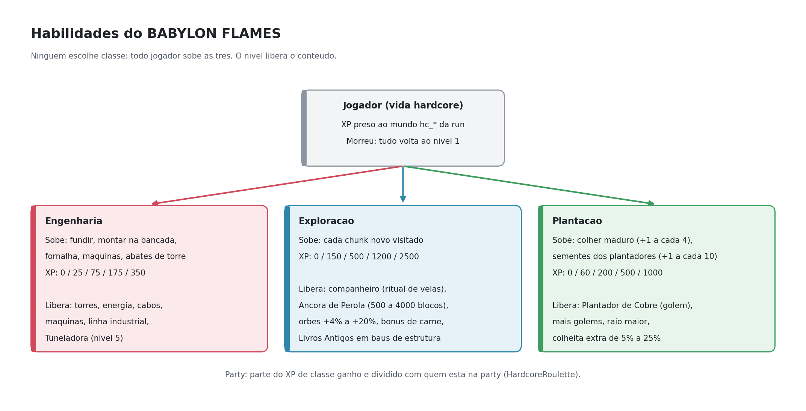
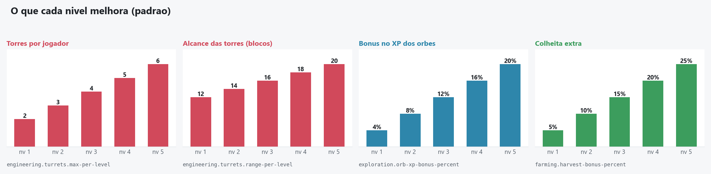
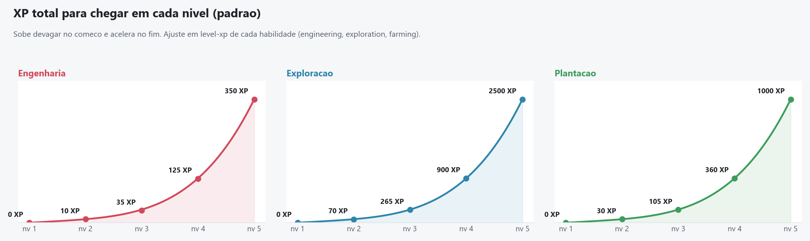
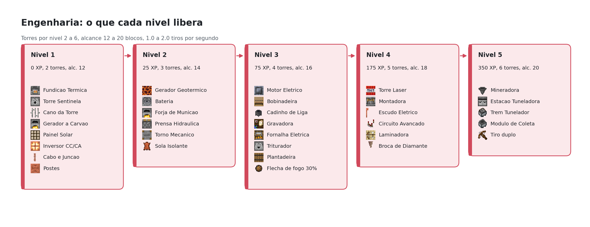
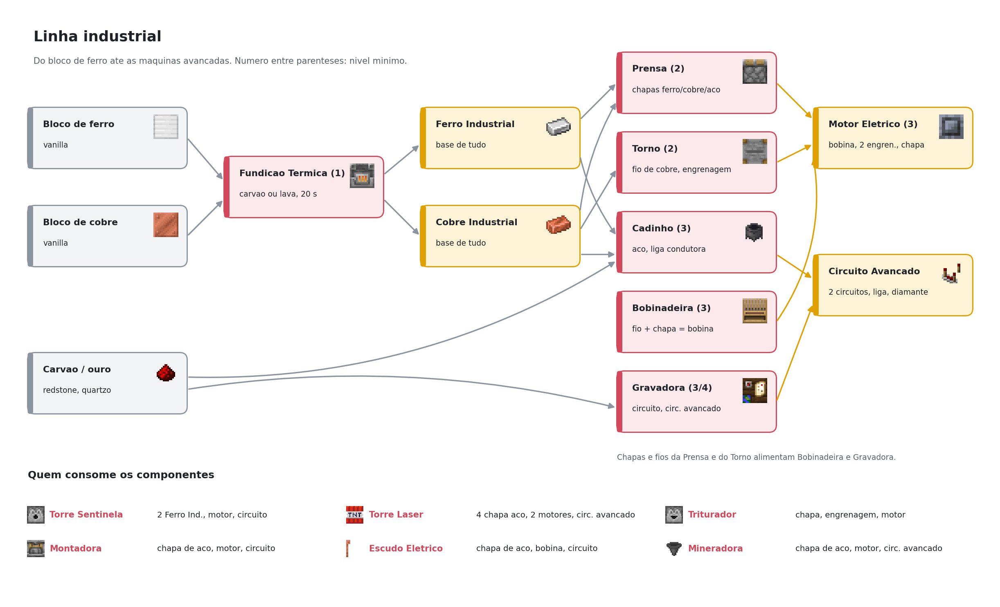
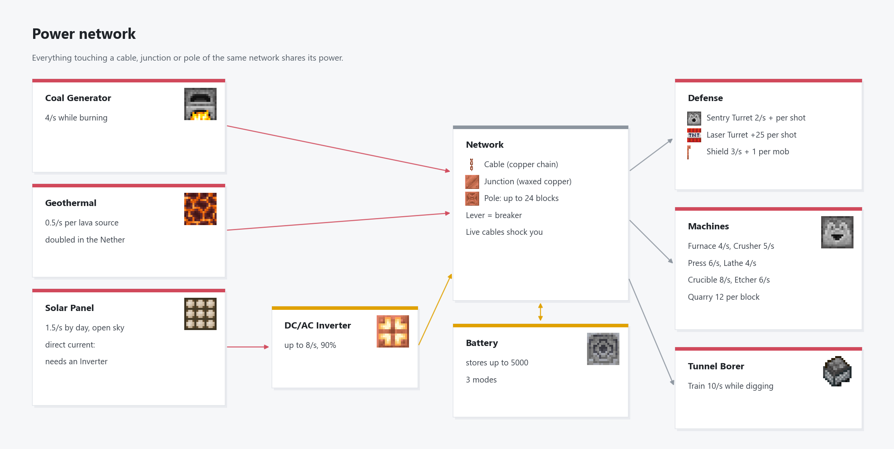
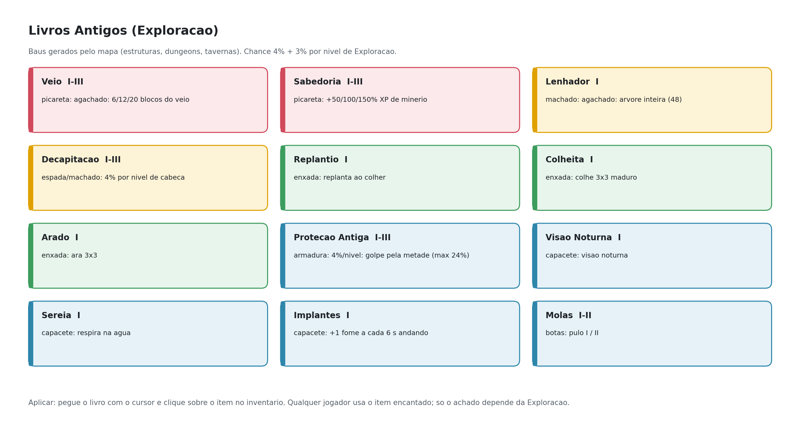
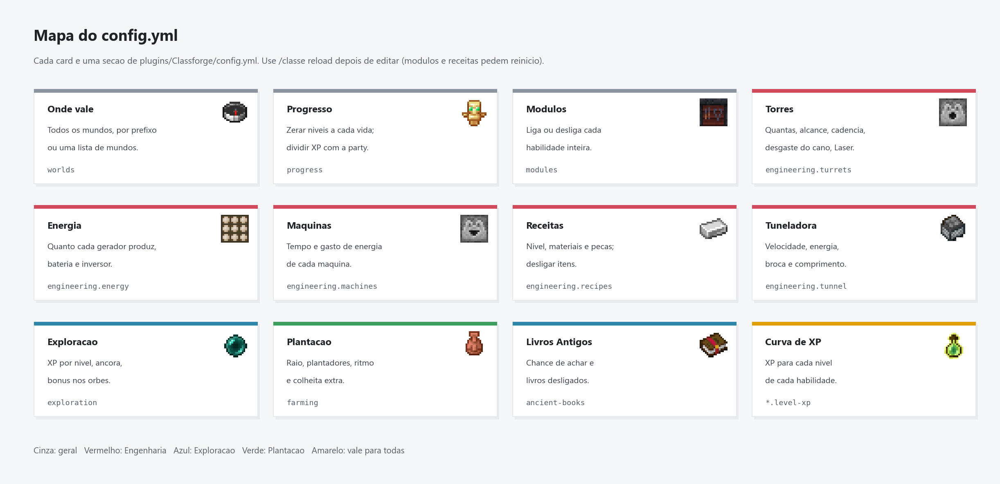

# Classforge

   

Plugin Paper de **habilidades por nivel** sem classes fixas. Todo jogador sobe Engenharia, Exploracao e Plantacao, e o nivel de cada uma libera conteudo novo: torres de defesa, energia e maquinas, companheiros e teleporte, plantadores automaticos e livros encantados raros. Tudo e configuravel (mundos, modulos, balanceamento e receitas). Mensagens em portugues (pt-BR).

Funciona sozinho em qualquer servidor Paper. Com o [HardcoreRoulette](https://github.com/matheus-fsc/hardcore-roulette) ganha funcoes especiais: veja [Integracao com o HardcoreRoulette](#integracao-com-o-hardcoreroulette).

## Recursos

- **Engenharia**: torres de defesa (Sentinela e Laser), energia, cabos e postes, maquinas, linha industrial e Tuneladora.
- **Exploracao**: companheiro, Ancora de Perola, bonus de XP e Livros Antigos em baus de estrutura.
- **Plantacao**: Plantador de Cobre (golem que planta a partir de um bau) e colheita extra.
- Menus proprios com receita 3x3 de cada item, etiquetas flutuantes e particulas de energia.

## Instalacao

1. Servidor **Paper 26.3** com **Java 25**.
2. Coloque `Classforge.jar` em `plugins/` e reinicie.
3. Opcional: [HardcoreRoulette](https://github.com/matheus-fsc/hardcore-roulette) para as funcoes especiais.

Vindo da versao antiga (HardcoreRouletteClasses): troque o jar. Na primeira partida o Classforge copia os dados de `plugins/HardcoreRouletteClasses/`, e itens, maquinas e livros que ja existem no mundo continuam funcionando.

## Integracao com o HardcoreRoulette

O HardcoreRoulette e um plugin de hardcore em grupo em que cada vida e um mundo novo. Com ele instalado, o Classforge ganha:

- **Vida por mundo**: os niveis ficam presos ao mundo da run e voltam ao nivel 1 quando a vida acaba (`progress.reset-on-new-world: true`, `worlds.mode: prefix`, `worlds.prefix: "hc_"`).
- **XP dividido com a party**: parte do XP de habilidade vai para quem esta na party, com o mesmo alcance e fracao que o HardcoreRoulette usa (`progress.party-share`).
- **Livros Antigos nas runs**: o loot de livros so aparece nos mundos de run.

Sem o HardcoreRoulette, essas funcoes ficam desligadas e o resto funciona igual. A ligacao e feita por reflexao, sem dependencia de compilacao.



## Mini wiki

| Pagina | O que tem |
|--------|-----------|
| [Inicio](docs/wiki/Home.md) | Visao geral, curvas por nivel, regras gerais |
| [Engenharia](docs/wiki/Engenharia.md) | Torres, Torre Laser, energia, maquinas, linha industrial, rede, Tuneladora |
| [Plantacao](docs/wiki/Plantacao.md) | Plantador de Cobre e colheita extra |
| [Exploracao](docs/wiki/Exploracao.md) | Companheiro, Ancora de Perola, orbes, Livros Antigos |
| [Arquitetura](docs/wiki/Arquitetura.md) | Classes Java, dados, geracao dos diagramas |

## Estado atual (versao 0.13.0)

| Area | Estado | Observacao |
|------|--------|------------|
| Engenharia: torres, energia, rede | Pronto | Torre Sentinela agora pede motor e circuito |
| Engenharia: linha industrial e maquinas | Pronto | Prensa, Torno, Bobinadeira, Cadinho, Gravadora |
| Engenharia: Tuneladora | Pronto | Nivel 5, limite de 1 estacao |
| Engenharia: Torre Laser | Novo, sem teste em jogo | Lanca TNT que nao explode; dano em area so em mobs hostis |
| Exploracao: companheiro, ancora, orbes | Pronto | |
| Exploracao: Livros Antigos (12) | Novo, sem teste em jogo | Loot de baus de estrutura |
| Plantacao: Plantador de Cobre | Pronto | Receita visivel no painel |
| Integracao com o HardcoreRoulette | Pronto | Vida por mundo e XP dividido com a party |
| Configuracao (config.yml) | Pronto | Mundos, modulos, balanceamento, receitas, `/classe reload` |

Ideias em aberto: habilidade de Coleta, revisao de balanceamento depois de uma run completa.

## Progressao



| Nivel | Engenharia (XP) | Exploracao (XP) | Plantacao (XP) |
|-------|-----------------|-----------------|----------------|
| 1 | 0 | 0 | 0 |
| 2 | 10 | 70 | 30 |
| 3 | 35 | 265 | 105 |
| 4 | 125 | 900 | 360 |
| 5 | 350 | 2500 | 1000 |

A curva comeca suave e fica ingreme nos niveis finais: `xp(n) = MAX x (0.1 x t + 0.9 x t^4)`, com `t = (n - 1) / 4`. Da para trocar os valores em `level-xp` no config.yml.





## Engenharia em uma imagem





Detalhes de cada maquina, receita e consumo na pagina [Engenharia](docs/wiki/Engenharia.md).

## Livros Antigos



## Configuracao

Tudo que era fixo no codigo agora fica em `plugins/Classforge/config.yml`, escrito comentado na primeira vez que o servidor liga ([modelo](src/main/resources/config.yml)). Os padroes sao os valores de antes, entao nada muda ate voce editar.



| Secao | O que controla |
|-------|----------------|
| `worlds` | Em quais mundos as habilidades valem: por prefixo (`hc_`), todos ou uma lista |
| `progress` | Zerar os niveis em mundo novo (vida nova) e dividir XP com a party |
| `modules` | Liga ou desliga Engenharia, Exploracao, Plantacao e Livros Antigos |
| `engineering` | XP por nivel, torres, balas, Torre Laser, geracao de energia, rede, maquinas, Tuneladora, XP de cada acao, etiquetas |
| `engineering.recipes` | Cada receita da Bancada: ligar/desligar, nivel, materiais e componentes (o plugin escreve todas na primeira vez) |
| `exploration` | XP por nivel, bonus nos orbes, Ancora de Perola |
| `farming` | XP por nivel, raio, plantadores, ritmo e colheita extra |
| `ancient-books` | Chance de achar, blocos do Veio e livros desligados |

`/classe reload` aplica os numeros sem reiniciar. Ligar ou desligar modulos e mudar receitas pede reinicio.

O padrao de uma instalacao nova e o de servidor comum: `worlds.mode: all` e `progress.reset-on-new-world: false`. Para o HardcoreRoulette, veja a secao de integracao.

## Comandos

| Comando | Descricao |
|---------|-----------|
| `/classe` (ou `/engenharia`, `/habilidades`) | Menu de habilidades |
| `/classe info` | Nivel e status da Engenharia |
| `/classe particulas` | Liga/desliga as particulas de energia |
| `/classe admin <jogador> <nivel>` | Define o nivel (permissao `classforge.admin`) |
| `/classe dar <item>` | Da um item do plugin (permissao `classforge.admin`) |
| `/classe reload` | Recarrega o config.yml (permissao `classforge.admin`) |
| `/classe give <engenheiro\|explorador\|plantador\|livros> [jogador]` | Kit de teste; `livros` da um de cada Livro Antigo (permissao `classforge.admin`) |

## Permissoes

| Permissao | Padrao | Descricao |
|-----------|--------|-----------|
| `classforge.admin` | op | `/classe admin`, `/classe dar` e `/classe give` |

## Build

```
mvn package
```

O jar sai em `target/Classforge.jar`. Copie para `plugins/`.

Para gerar os diagramas de novo: `python docs/diagrams.py` (precisa de matplotlib e do Minecraft instalado para os icones; detalhes em [Arquitetura](docs/wiki/Arquitetura.md)).

## Para desenvolvedores

Estrutura do codigo, arquivos de dados e como gerar os diagramas: [Arquitetura](docs/wiki/Arquitetura.md).

## Licenca

MIT
