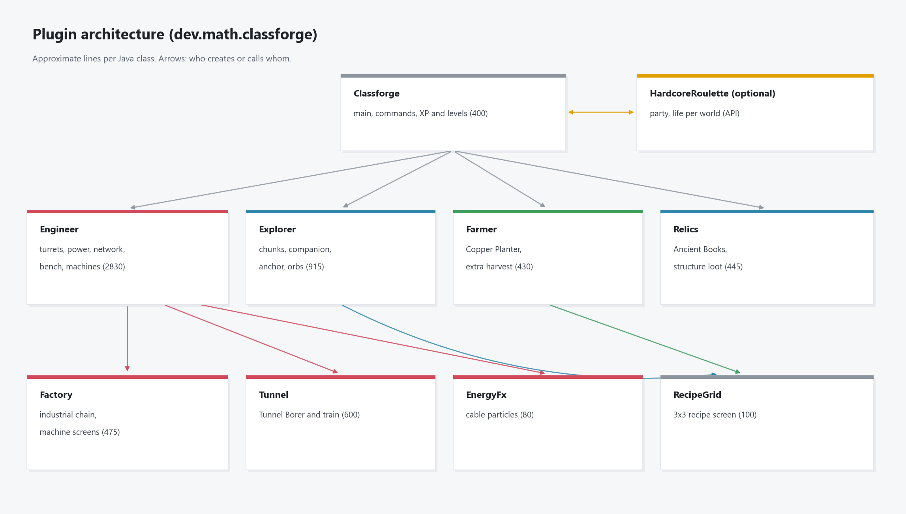

# Arquitetura (para desenvolvedores)

Esta pagina e para quem vai mexer no codigo. Para configurar o plugin, veja a secao Configuracao do README.

[Inicio](Home.md) | [Engenharia](Engenharia.md) | [Plantacao](Plantacao.md) | [Exploracao](Exploracao.md) | [Arquitetura](Arquitetura.md)



## Classes

| Classe | Papel |
|--------|-------|
| `Classforge` | Classe principal: comandos, XP e niveis das tres habilidades, divisao de XP com a party |
| `Engineer` | Bancada, torres (Sentinela e Laser), geradores, bateria, cabos, postes, etiquetas, maquinas simples |
| `Factory` | Linha industrial (Prensa, Torno, Bobinadeira, Cadinho, Gravadora, Laminadora) e a tela das maquinas |
| `Tunnel` | Estacao, Trem Tunelador, brocas e Modulo de Coleta |
| `EnergyFx` | Particulas de energia correndo pelos cabos |
| `Explorer` | Chunks, companheiro, Ancora de Perola, bonus de orbes e de carne |
| `Farmer` | Plantador de Cobre (golem) e colheita extra |
| `Relics` | Livros Antigos: loot de estrutura, aplicacao no item e efeitos |
| `RecipeGrid` | Tela generica de receita 3x3 usada pelos paineis |
| `Settings` | Le o config.yml e aplica nos campos de balanceamento e nas receitas |

## Integracao com o HardcoreRoulette

O plugin nao depende do HardcoreRoulette para compilar. A divisao de XP com a party usa reflexao
(`xpShareTargets` e `xpShareRatio`); se o HardcoreRoulette nao estiver carregado, nada e dividido.

## Dados

| Arquivo | Conteudo |
|---------|----------|
| `config.yml` | Configuracao (mundos, modulos, balanceamento, receitas) |
| `players.yml` | XP e mundo de cada jogador |
| `devices.yml` | Dispositivos, cabos e postes |
| `explorer.yml` | Companheiros e ancoras |
| `farm.yml` | Plantadores |

Todos em `plugins/Classforge/`.

## Diagramas

As imagens em `docs/img/` saem de `docs/diagrams.py` (matplotlib):

```
pip install matplotlib
python docs/diagrams.py
```

Os numeros do script copiam as constantes do codigo. Ao mudar um balanceamento, ajuste o script e gere de novo.

Os icones de itens e blocos saem das texturas do Minecraft instalado no PC: o script acha o jar do cliente mais novo em `.minecraft/versions` e extrai as texturas para `docs/.textures` (fora do git). Para escolher outro jar, use `MC_JAR=<caminho do jar>`; para gerar sem icones, `MC_TEXTURES=off`. O mapa de item para textura fica no dicionario `ICON` do script.

As texturas do Minecraft sao da Mojang; aqui aparecem so como icones dentro dos diagramas.
