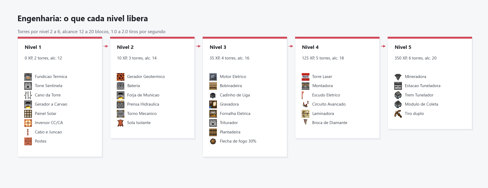
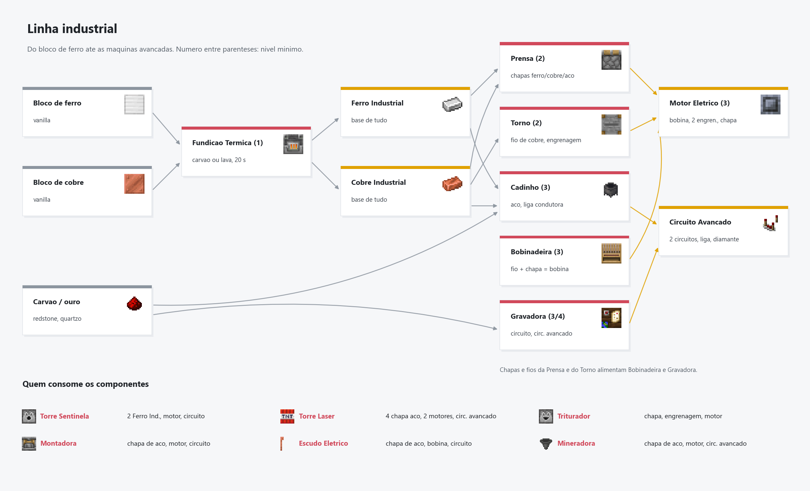
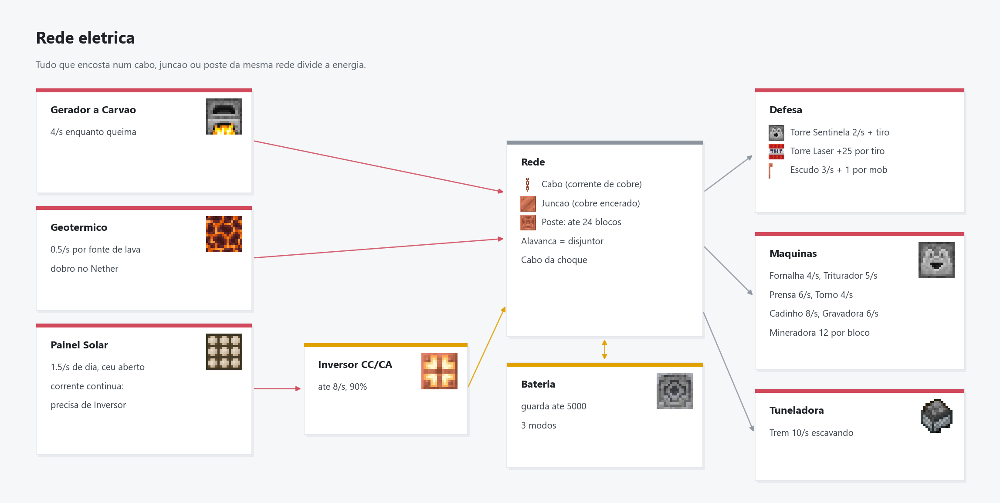

# Engenharia

[Inicio](Home.md) | [Engenharia](Engenharia.md) | [Plantacao](Plantacao.md) | [Exploracao](Exploracao.md) | [Arquitetura](Arquitetura.md)

## Niveis

| Nivel | XP  | Torres | Alcance | Tiros/s | Extra |
|-------|-----|--------|---------|---------|-------|
| 1     | 0   | 2      | 12      | 1.0     |       |
| 2     | 10  | 3      | 14      | 1.2     | Geotermico, Bateria e Forja |
| 3     | 35  | 4      | 16      | 1.4     | Flecha de fogo (30%) |
| 4     | 125 | 5      | 18      | 1.7     |       |
| 5     | 350 | 6      | 20      | 2.0     | Tiro duplo |

XP (o painel mostra tudo no frasco de XP):

- Fundir Ferro ou Cobre Industrial na Fundicao Termica: +2 cada.
- Montar na bancada: cabo e juncao +2, cano +4, energia +6, torre e fundicao +10, maquinas +12.
- Tirar lingote de ferro, cobre ou ouro da fornalha: +1 a cada 5.
- Craftar item mecanico (pistao, funil, trilho, observador, bigorna e afins): +2.
- Consertar item na bigorna: +4. Trocar o cano de uma torre: +8. Abate de uma torre sua: +2.
- Forja: +1 por lote. Fornalha eletrica e triturador: +1 a cada 4 itens. Montadora e mineradora nao dao XP.
- Prensa, torno, bobinadeira, cadinho e gravadora: +1 a cada 2 lotes.

## Bancada de Engenharia
Receita na mesa de trabalho: mesa de trabalho no centro, 5 ferros embaixo e dos lados, 1 redstone em cima. Clique com o direito nela para montar os dispositivos. No painel, clicar num item mostra o craft dele.

## Dispositivos

- **Torre Laser** (nivel 4, dispenser): trava a mira com um feixe vermelho e lanca TNT. O TNT nao explode nem quebra blocos: ao cair causa 8 de dano (+1 por nivel) em area, raio 3,5, so em mobs hostis. Municao: TNT dentro dela. 25 energia por tiro, alcance da torre + 4. Usa o mesmo menu de filtro e prioridade e conta no limite de torres. Receita: dispenser, 4 TNT, 2 blocos de redstone, 4 chapas de aco, 2 motores e 1 circuito avancado.
- **Torre Sentinela** (dispenser; receita com 2 Ferro Industrial, 1 motor e 1 circuito): atira flechas (normais, com efeito, espectrais), bolas de fogo ou balas guardadas nela em mobs hostis. Mira na frente do alvo e compensa a queda da flecha. Nunca acerta jogador, pet ou animal. Menu com municao preferida, prioridade de alvo, filtro de mobs, liga/desliga e alcance.
  - Consome energia ligada mesmo parada (2.0/s, sobe com o nivel) e mais por tiro (5 flecha, 10 bola de fogo, 2 por bala de cobre, 3 por bala de ferro).
  - **Cano**: aguenta 300 tiros (bola de fogo e rajada de ferro contam 2, rajada de cobre conta 1). Gasto, a torre para. Troque pelo menu da torre com um Cano da Torre. O desgaste fica salvo no item se a torre for quebrada.
- **Gerador a Carvao** (fornalha): 4 energia/s enquanto queima.
- **Gerador Geotermico** (bloco de magma): 0.5/s por fonte de lava encostada, dobro no Nether.
- **Painel Solar** (sensor de luz): 1.5/s de dia com ceu aberto. Gera corrente continua: precisa de um **Inversor CC/CA** na rede (ate 8/s, 90% de eficiencia).
- **Bateria** (magnetita): guarda ate 5000. Modos: carrega e fornece, so carrega, so fornece.
- **Forja de Municao** (fornalha, nivel 2): 9 pepitas de ferro ou cobre viram 16 balas em 6 segundos, gastando 4 energia/s da rede. Funil em cima abastece, funil embaixo retira. Nao derrete minerio.
  - Balas saem em rajada de 3 tiros retos (3x a cadencia da flecha), com pouco dano cada. Uma flecha da cerca de 6.
  - **Bala de Cobre**: 2 de dano por bala (+0.25 por nivel), 2 de energia por bala, 1 de cano por rajada.
  - **Bala de Ferro**: 3 de dano por bala (+0.25 por nivel), 3 de energia por bala, 2 de cano por rajada.

## Maquinas

Todas gastam energia da rede enquanto trabalham e so processam o que voce coloca nelas. Clique numa maquina para ver o menu (liga/desliga, inventario, etiqueta, rede).

- **Fundicao Termica** (alto-forno, nivel 1): nao usa energia. Funde 1 bloco de ferro em 1 **Ferro Industrial** ou 1 bloco de cobre em 1 **Cobre Industrial** (20 s cada). Queima so bloco de carvao (8 itens) ou balde de lava (10 itens, o balde vazio volta). E o comeco da cadeia: todo craft da Engenharia (menos a bancada e a propria fundicao) usa Ferro e Cobre Industrial, e toda maquina que gasta energia leva um bloco de redstone.
- **Fornalha Eletrica** (defumador, nivel 3): derrete tudo que a fornalha comum derrete, 2x mais rapido, sem combustivel. 4 energia/s (20 por item).
- **Triturador** (liberador, nivel 3): minerio bruto (ou bloco de minerio) vira minerio triturado, com 35% de chance de render 1 a mais. Triturado derrete como o bruto. Pedregulho vira cascalho e cascalho separa em 1 areia e 2 flint (35% de chance de 3 flint), bom para farm de flecha. 5 energia/s, 4 s por item. Saida no bau embaixo ou no proprio inventario; funil so puxa o que ja foi triturado.
- **Plantadeira** (barril, nivel 3): planta as sementes guardadas nela na terra arada em volta (raio 4, nivel 4: 5, nivel 5: 6). Fungo do Nether vai na areia das almas. 1 energia por semente.
- **Montadora** (crafter, nivel 4): monta sozinha um item da bancada (escolha no menu). Materiais dentro dela ou no bau em cima, resultado no bau ou funil embaixo. 5 energia/s, 10 s por item. Nao da XP.
- **Escudo Eletrico** (para-raios, nivel 4): empurra mobs hostis num raio de 5 (nivel 5: 6) com descargas de 1 de dano. 3 energia/s ligado e 1 por mob. Limite de 1 (nivel 5: 2).
- **Mineradora** (funil, nivel 5): escava uma area 5x5 embaixo dela, camada por camada, ate o fundo do mundo. 1 bloco a cada 3 s, 12 energia por bloco. Os itens caem no funil (aponte para um bau). Nao quebra baus, maquinas, cabos, liquidos nem bedrock. Limite de 1.

## Linha industrial (componentes)

As maquinas avancadas nao saem mais so de Ferro/Cobre Industrial: pedem pecas que so existem saindo de uma maquina especifica.

| Maquina (bloco) | Nivel | Energia | Entra | Sai |
|---|---|---|---|---|
| **Prensa Hidraulica** (pistao) | 2 | 6/s | 1 Ferro Industrial | 2 Chapa de Ferro (6 s) |
| | 2 | | 1 Cobre Industrial | 2 Chapa de Cobre (6 s) |
| | 3 | | 1 Aco | 2 Chapa de Aco (10 s) |
| **Torno Mecanico** (cortador de pedra) | 2 | 4/s | 1 Cobre Industrial | 6 Fio de Cobre (5 s) |
| | 2 | | 1 Chapa de Ferro | 2 Engrenagem (6 s) |
| **Bobinadeira** (tear) | 3 | 5/s | 6 Fio de Cobre + 1 Chapa de Ferro | 2 Bobina de Cobre (8 s) |
| **Cadinho de Liga** (caldeirao) | 3 | 8/s | 2 Ferro Industrial + 4 carvao | 2 Aco (15 s) |
| | 3 | | 1 Cobre Industrial + 1 ouro + 4 redstone | 2 Liga Condutora (12 s) |
| **Gravadora de Circuitos** (mesa de cartografia) | 3 | 6/s | 1 Chapa de Cobre + 2 redstone + 1 quartzo | 1 Circuito de Redstone (10 s) |
| | 4 | | 2 Circuito + 1 Liga Condutora + 1 diamante | 1 Circuito Avancado (20 s) |

O **Motor Eletrico** e montado na bancada (nivel 3): 1 bobina, 2 engrenagens, 1 chapa de ferro e 2 redstone.

Quem usa o que: Fornalha Eletrica (chapa de ferro, bobina), Triturador (chapa, engrenagem, motor), Plantadeira (chapa, engrenagem, fio), Montadora (chapa de aco, motor, circuito), Escudo (chapa de aco, bobina, circuito), Mineradora (chapa de aco, motor, circuito avancado). Torre, cano, geradores, bateria, cabos e forja continuam so com Ferro/Cobre Industrial.

**Interface propria**: clicar numa dessas maquinas abre a tela dela, que e o proprio inventario: 3 espacos de entrada, barra de progresso, 2 de saida, as receitas da maquina (com a que esta em producao brilhando), medidor de energia da rede e os botoes de ligar, etiqueta e mostrar rede. A entrada so aceita o que a maquina usa; a saida so deixa retirar. Varios jogadores podem abrir ao mesmo tempo.

**Automacao**: bau em cima abastece (a maquina puxa so o que usa), bau embaixo recebe. Empilhar duas maquinas de processo faz a de cima entregar direto na entrada da de baixo (ex.: Prensa em cima do Torno = ferro industrial vira engrenagem).

## Tuneladora (nivel 5)

Abre um tunel reto 3x3, bem devagar, assentando trilho no chao e Cabo de Energia no teto (o cabo ja sai ligado na rede da estacao).

- **Laminadora de Trilhos** (mesa de flechas, nivel 4, 5 energia/s): 4 lingotes de ferro + 2 madeiras (tabua ou tronco) = 16 trilhos em 8 s. Em cima da estacao, entrega os trilhos direto nela.
- **Broca de Diamante** (bancada, nivel 4): 3 diamantes, 1 chapa de aco, 1 engrenagem. Aguenta 1800 blocos escavados.
- **Estacao da Tuneladora** (observador, nivel 5, limite de 1): o tunel sai na direcao em que voce olha ao colocar. Guarda trilhos, cabos e brocas (bau em cima abastece) e recebe a carga (bau embaixo).
- **Trem Tunelador** (nivel 5): carrinho de fornalha que vai na estacao. 1 bloco de tunel a cada 4 s, 10 energia/s enquanto escava, 1 trilho por bloco, 1 cabo por bloco se tiver. Tunel de ate 1024 blocos.
- Broca gasta: o trem troca sozinho por uma reserva da estacao (10 s parado). Sem reserva, para.
- Agua, lava, areia e cascalho em volta do tunel viram pedra (revestimento); buraco embaixo do trilho ganha piso. Bau, maquina, cabo, poste ou bedrock na frente: o trem para e avisa o dono.
- **Modulo de Coleta** (nivel 5, upgrade da estacao): o trem guarda o que escava e manda um vagao-bau de volta (a cada 16 blocos ou com 27 pilhas), que descarrega na estacao. Sem o modulo, os itens caem no tunel.

A bancada e o painel separam as receitas em abas: Defesa, Energia, Maquinas e Componentes. Na aba, clique para ver o craft ou shift-clique para montar direto.

## Rede eletrica

- **Cabo** (corrente de cobre encerada): liga tudo que encosta nele. Qualquer corrente de cobre conduz.
- **Juncao** (bloco de cobre encerado): conduz como o cabo, serve para curvas e emendas.
- **Alavanca** no meio do cabo funciona como disjuntor.
- **Poste**: muro de pedregulho na base, 1 a 8 blocos de madeira e cobre talhado no topo. Liga com outros postes a ate 24 blocos sem fio (com fio visual em particulas). Para tirar energia do poste, encoste cabo ou juncao em qualquer parte dele.
- Cabo energizado da choque continuo (a cada meio segundo enquanto encostar) e lentidao II.
  - Armadura de ferro, ouro, cobre ou malha conduz: +25% de dano por peca (2x com o conjunto todo). Diamante e netherita sao neutros.
  - Bota de couro: metade do dano e sem lentidao.
  - **Sola Isolante** (bancada, nivel 2: 2 couros, 4 algas secas, 1 chapa de cobre): modulo de armadura. No inventario, clique com ela em cima de qualquer bota; bota isolada nao leva choque.
- Etiquetas flutuantes mostram energia, municao e estado de cada maquina. Particulas de energia correm pelos cabos ate as maquinas (`/classe particulas` liga e desliga).
