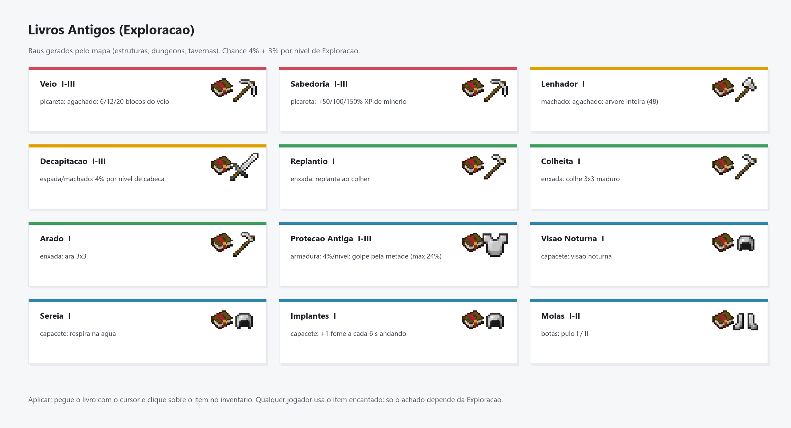

# Exploracao

[Inicio](Home.md) | [Engenharia](Engenharia.md) | [Plantacao](Plantacao.md) | [Exploracao](Exploracao.md) | [Arquitetura](Arquitetura.md)

Alem do companheiro, da Ancora de Perola e do bonus de carne: os orbes de XP rendem +4% por nivel (4, 8, 12, 16 e 20% no maximo), so no mundo da run.

## Resumo

- **XP**: cada chunk novo visitado na vida conta.
- **Companheiro**: lobo, raposa ou gato, invocado num ritual de velas. A raposa tem mochila (3, 4, 5, 7 e 9 espacos por nivel) e pega itens do chao.
- **Ancora de Perola** (nivel 2): ate 2 ancoras por jogador, teleporte entre elas na mesma dimensao. Custa niveis de XP pela distancia.
- **Carne**: bonus de saturacao.
- **Orbes de XP**: +4% por nivel, maximo 20%, so no mundo da run.

## Livros Antigos

Baus de estrutura gerados pelo mapa podem trazer um livro (7% no nivel 1 ate 19% no nivel 5) com Veio, Replantio, Decapitacao, Protecao Antiga, Lenhador, Colheita, Arado, Sabedoria, Visao Noturna, Sereia, Molas ou Implantes. Clique com o livro sobre o item no inventario para aplicar.

| Nivel | XP | Alcance da Ancora | Bonus nos orbes | Chance de livro |
|-------|------|------|-----|-----|
| 1 | 0 | sem ancora | 4% | 7% |
| 2 | 70 | 500 | 8% | 10% |
| 3 | 265 | 1000 | 12% | 13% |
| 4 | 900 | 2000 | 16% | 16% |
| 5 | 2500 | 4000 | 20% | 19% |
