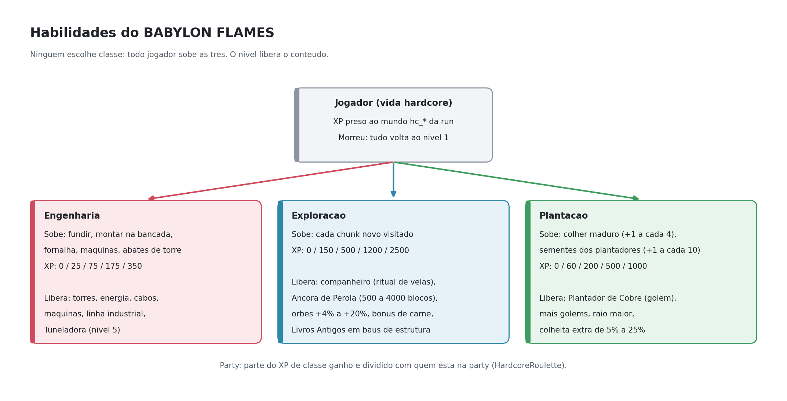
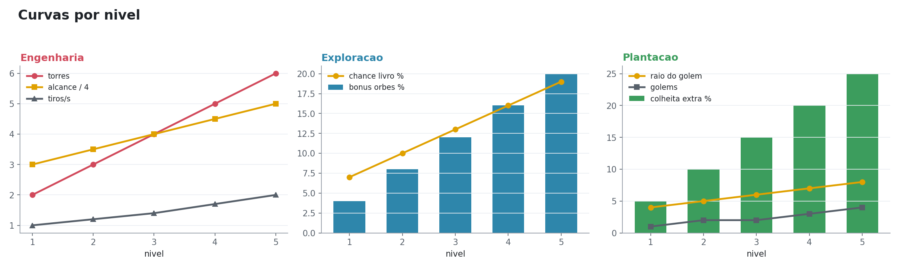

# Wiki: HardcoreRoulette Classes

[Inicio](Home.md) | [Engenharia](Engenharia.md) | [Plantacao](Plantacao.md) | [Exploracao](Exploracao.md) | [Arquitetura](Arquitetura.md)

Mini wiki do plugin de habilidades do BABYLON FLAMES. Cada pagina tem os diagramas e as tabelas de uma habilidade.

## Paginas

| Pagina | O que tem |
|--------|-----------|
| [Engenharia](Engenharia.md) | Niveis, torres, Torre Laser, energia, maquinas, linha industrial, rede eletrica, Tuneladora |
| [Plantacao](Plantacao.md) | Plantador de Cobre, niveis, colheita extra |
| [Exploracao](Exploracao.md) | Chunks, companheiro, Ancora de Perola, orbes, Livros Antigos |
| [Arquitetura](Arquitetura.md) | Classes Java, arquivos de dados, como gerar os diagramas |

## Curvas por nivel

## Regras gerais

- Todo jogador sobe as tres habilidades; nao existe escolha de classe.
- O XP fica preso ao mundo `hc_*` da run. Morreu, comeca do nivel 1 na proxima vida.
- Parte do XP de classe ganho e dividido com a party (integracao com o HardcoreRoulette).
- `/classe` abre o menu. Nos paineis, clicar num item mostra a receita 3x3 dele.
